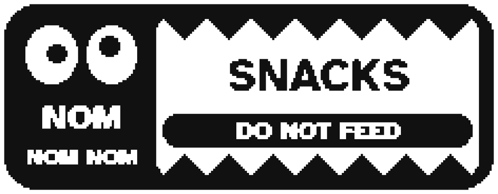
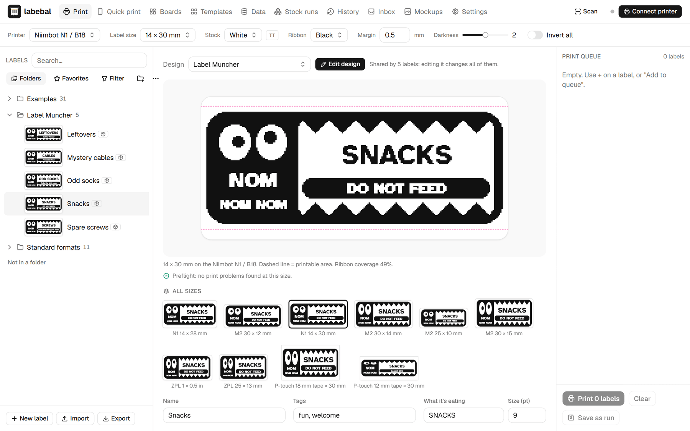
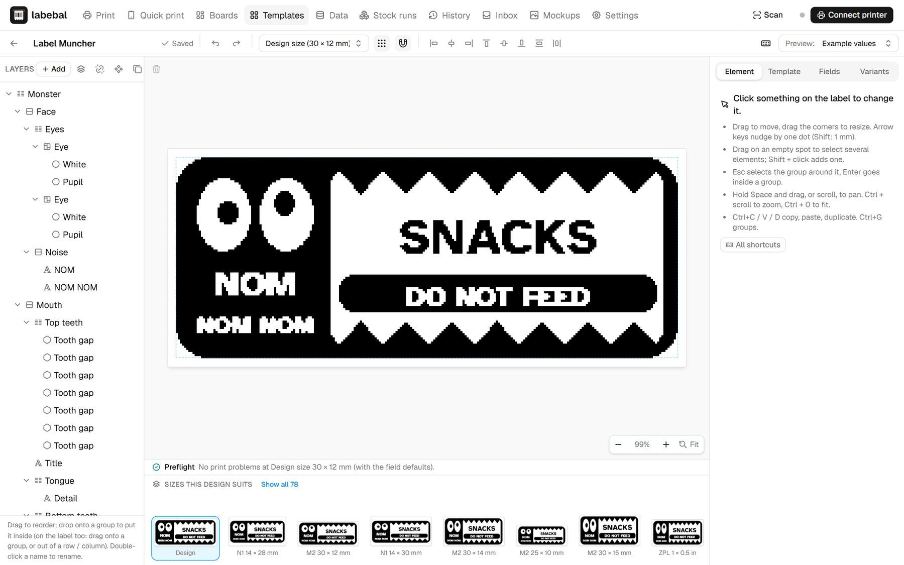
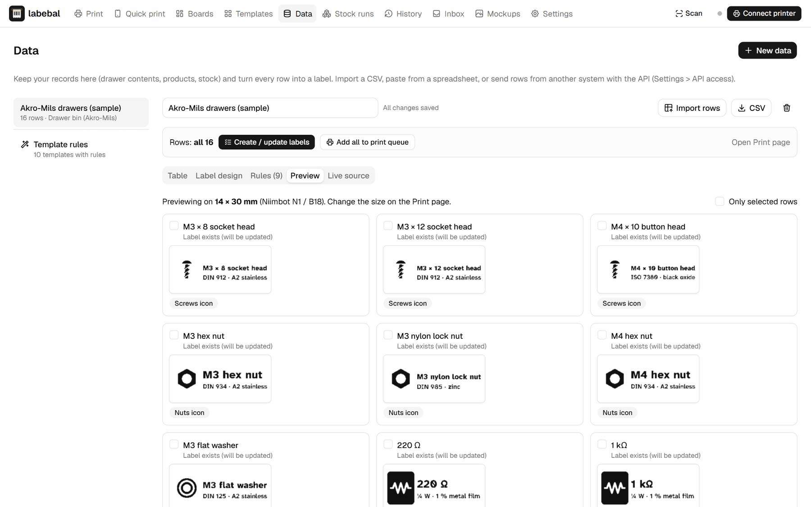
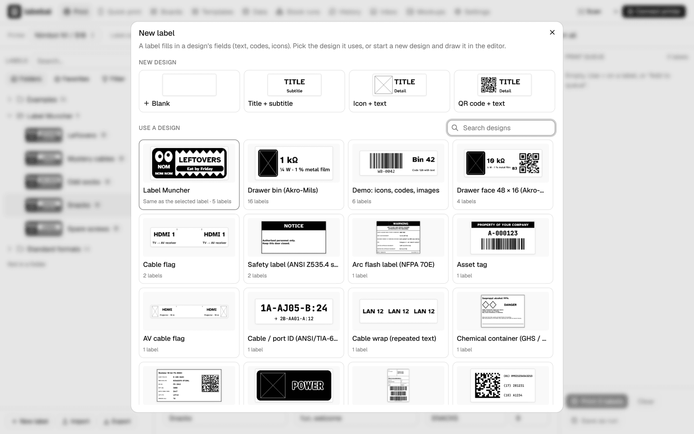
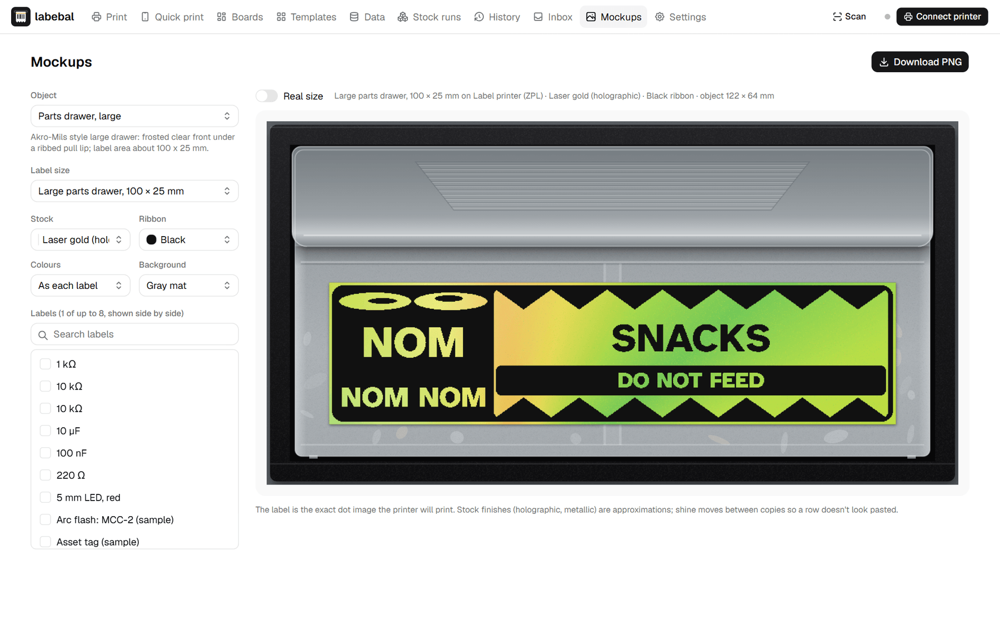

<p align="center">
  
</p>

<h1 align="center">labebal</h1>

<p align="center">
  Design and print labels from the browser. Niimbot, Brother P-touch and Zebra.<br>
  <a href="https://formless63.github.io/labebal/">Docs</a> ·
  <a href="https://formless63.github.io/labebal/guide/start">Get started</a> ·
  <a href="https://formless63.github.io/labebal/rest">REST API</a> ·
  <a href="https://formless63.github.io/labebal/embedding">Embed it</a>
</p>

<p align="center">
  <a href="https://github.com/formless63/labebal/actions/workflows/ci.yml"></a>
  <a href="https://www.npmjs.com/package/@labebal/app"></a>
  <a href="https://github.com/formless63/labebal/pkgs/container/labebal"></a>
  <a href="LICENSE"></a>
</p>

<picture>
  <source media="(prefers-color-scheme: dark)" srcset="docs/public/screens/print-dark.png">
  
</picture>

- **Nothing to install to print.** Open it in Chrome or Edge, connect a printer over Bluetooth or USB, print.
- **One design, every size.** Templates reflow from a 14 mm tape to a 4 x 6 inch label.
- **What you see is what prints.** The preview is the exact dot image sent to the printer, with warnings before you waste a label.
- **Labels from data.** Spreadsheets, Google Sheets, JSON APIs, rules, counters and a REST API.
- **Run it or embed it.** One container with its own database, or a React component plus a request handler in your app.

## Run it

```sh
docker run -d --name labebal -p 3000:3000 -v labebal-data:/data --restart unless-stopped ghcr.io/formless63/labebal:latest
```

Then open http://localhost:3000. Printing from other devices needs HTTPS, and
labebal has no login of its own, so put it behind a reverse proxy:
[deploying](https://formless63.github.io/labebal/deploy).

## Embed it

```sh
npm install @labebal/app @labebal/core drizzle-orm
```

```ts
import { createLabebalServer } from "@labebal/app/server";

export const labebal = createLabebalServer({ db, basePath: "/labels", user: async (req) => yourUser(req) });
// send requests under /labels/api/ to labebal.handler(request)
```

```tsx
import { LabebalApp } from "@labebal/app";

<LabebalApp basePath="/labels" chrome="embedded" />;
```

Works in any React 18.3 / 19 app with a Postgres database: [embedding guide](https://formless63.github.io/labebal/embedding).

## A look around

| Design | Labels from data |
| --- | --- |
|  |  |
| **Start from a design** | **See it on the object** |
|  |  |

## Printers

| Printer | Connects by |
| --- | --- |
| Niimbot N1 / B18, M2 | Bluetooth or USB, from the browser |
| Brother P-touch PT-D610BT | Its Bluetooth serial port, from the browser |
| Zebra and other ZPL printers | The network, through the server |

## Develop

Needs Node 22 or newer and pnpm.

```sh
pnpm install
pnpm dev        # http://localhost:3000
pnpm test
pnpm typecheck
```

| Path | What |
| --- | --- |
| `packages/core` | `@labebal/core`: the label engine, free of any framework. |
| `packages/app` | `@labebal/app`: the screens and the API as a module. |
| `apps/web` | The standalone app the container runs. |
| `examples/vite-host` | The module in a Vite app with a plain Node server. |
| `docs` | The documentation and the site that publishes it. |

Design notes: [architecture](docs/ARCHITECTURE.md), [roadmap](docs/ROADMAP.md).

## Licence

MIT, see [LICENSE](LICENSE). Fonts and libraries: [THIRD-PARTY.md](THIRD-PARTY.md).
Not affiliated with Niimbot, Brother or Zebra.
